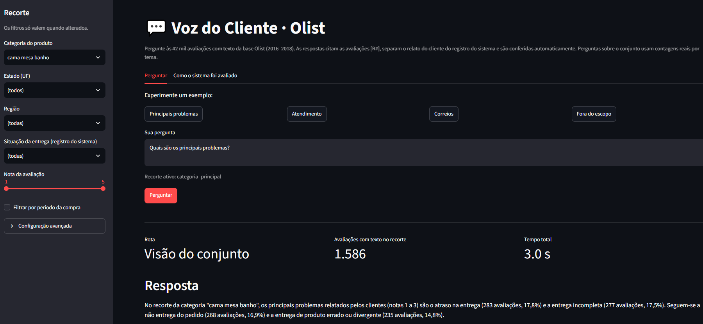
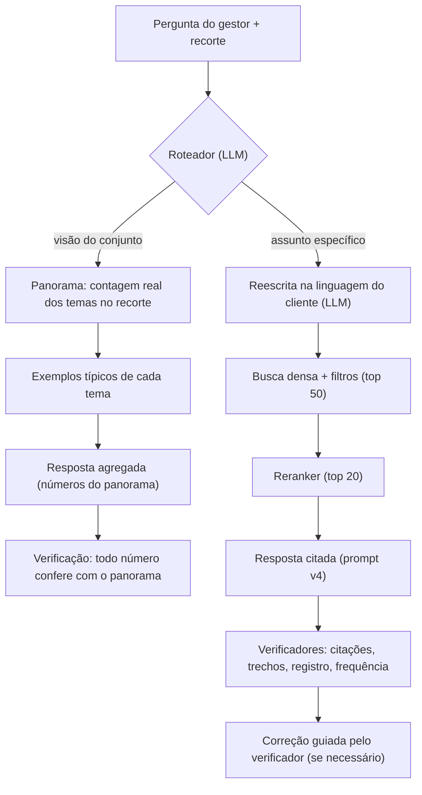

# Voz do Cliente · Olist — Voice of Customer Intelligence com RAG

**Tech Challenge — Fase 4 · FIAP PosTech AI Scientist**
Autor: Guilherme Diniz Leocadio

Um sistema que responde, em linguagem natural, perguntas de gestores sobre as **42 mil avaliações
com texto** da base pública da Olist (2016–2018), **citando as avaliações** que sustentam cada
afirmação, **separando o relato do cliente do registro do sistema** e **recusando** quando a base
não tem evidência. Perguntas sobre o conjunto ("quais são os principais problemas?") são
respondidas com **contagens reais por tema**, e não com uma amostra.

> 🎥 **Vídeo de apresentação:** _(link)_



---

## Sumário

1. [O problema e a solução](#1-o-problema-e-a-solução)
2. [Arquitetura](#2-arquitetura)
3. [Preparação da base de conhecimento](#3-preparação-da-base-de-conhecimento)
4. [Pipeline RAG, passo a passo](#4-pipeline-rag-passo-a-passo)
5. [Desafio adicional: metadados](#5-desafio-adicional-metadados)
6. [Como rodar](#6-como-rodar)
7. [Exemplos de perguntas e respostas](#7-exemplos-de-perguntas-e-respostas)
8. [Avaliação](#8-avaliação)
9. [Decisões e achados](#9-decisões-e-achados)
10. [Limitações](#10-limitações)
11. [Estrutura do repositório](#11-estrutura-do-repositório)
12. [Dados e licença](#12-dados-e-licença)

---

## 1. O problema e a solução

Avaliações de clientes contêm o que nenhum indicador mostra: **por que** o cliente está
insatisfeito. Mas ler milhares de textos curtos e ruidosos não é viável, e um LLM sozinho
**inventa**: frequências, causas e citações.

O sistema combina **busca** (para encontrar as avaliações certas), **geração com regras** (para
responder citando) e **verificação no código** (para não confiar só no LLM):

| Tipo de pergunta | Exemplo | Como o sistema responde |
|---|---|---|
| **Visão do conjunto** | "Quais são os principais problemas?" | Conta **todas** as avaliações do recorte por tema e responde com os números reais, ilustrados com exemplos citados |
| **Assunto específico** | "O que os clientes relatam sobre os Correios?" | Busca as 20 avaliações mais relevantes e responde citando cada uma [R#], com trechos literais |
| **Fora do escopo / sem evidência** | "Qual foi o faturamento da Olist?", "O que dizem sobre pagar com Pix?" | **Recusa**, explica o motivo e sugere o que a base consegue responder |

Todas aceitam **recortes**: categoria, estado, região, situação da entrega, nota e período da compra.

---

## 2. Arquitetura



| Componente | Escolha | Por quê |
|---|---|---|
| Embedding | `intfloat/multilingual-e5-large-instruct` (local, CPU) | Melhor modelo aberto para português testado; sem chave de API |
| Banco vetorial | ChromaDB (persistente, local) | Filtros por metadados; instalação com `pip`, sem Docker |
| Reranker | `BAAI/bge-reranker-v2-m3` (local) | +7,5 pontos de precisão; multilíngue |
| Redator | `qwen/qwen3.8-27b` via Groq | Mais fiel que o `gpt-oss-120b` na avaliação (seção 8) |
| Juiz (avaliação) | `gemini-3.5-flash-lite` via Google AI Studio | Gratuito; validado contra notas humanas |
| Temas | K-means sobre os embeddings + nomes dados pelo LLM | Temas vindos dos dados, não de uma lista pronta |
| Interface | Streamlit | Chama o mesmo `pipeline.responder` avaliado |

**Custo:** zero. Modelos de embedding e reranker rodam localmente; o redator e o juiz usam as
camadas gratuitas do Groq e do Google AI Studio.

### Tecnologias e bibliotecas

| Biblioteca / serviço | Uso no projeto |
|---|---|
| Python 3.13 | Linguagem de todo o projeto |
| `pandas` | Leitura dos CSVs, limpeza, ficha dos documentos (Parquet), estatísticas e contagens do panorama |
| `sentence-transformers` + `torch` (CPU) | Embeddings (e5) e reranker (`CrossEncoder`) |
| `chromadb` | Banco vetorial persistente com filtros por metadados |
| `bm25s` + `PyStemmer` | Busca por palavras (BM25), com e sem redução ao radical; usada nos experimentos de busca híbrida |
| `scikit-learn` | `MiniBatchKMeans` da camada de temas |
| `openai` (cliente) | Cliente único, compatível com a API da OpenAI, para Groq e Google AI Studio: trocar de provedor é mudar o `.env` |
| `difflib` (biblioteca padrão) | Conferência dos trechos entre aspas por semelhança de texto |
| `streamlit` | Interface web |
| Groq / Google AI Studio | Redator (Qwen) e juiz (Gemini), nas camadas gratuitas |

As versões estão fixadas em `requirements.txt`, que lista **só as dependências diretas**: um
`pip freeze` completo no Windows inclui pacotes da plataforma que quebram a instalação em
Linux/macOS. Os modelos são chamados por **nome fixo**, nunca por apelidos como `latest`, que mudam
de versão sem aviso.

---

## 3. Preparação da base de conhecimento

Código: `src/ingestao/construir_corpus.py` e `src/indexacao/construir_indice.py`. Análise
exploratória completa em `notebooks/01_eda.ipynb`.

### Seleção dos dados
- **6 CSVs da Olist:** avaliações, pedidos, itens, produtos, tradução de categorias e clientes.
  Das tabelas além das avaliações vêm só os **metadados** usados como filtro (entrega, categoria,
  data, estado).
- **Só avaliações com texto viram documento de busca:** 42.687 das 99.224 linhas (43%) têm título
  ou mensagem. As **sem texto ficam fora da busca, mas entram nas estatísticas**, porque a nota
  continua sendo informação sobre o cliente.
- **Fora de escopo, de propósito:** vendedor, preço e tempo total de entrega (não exigidos pelo
  desafio e fáceis de acrescentar).

### Limpeza e preparação dos textos
- **Limpeza leve:** título + mensagem num único texto; quebras de linha (`\r\n`) viram espaço.
- **Sem remoção de stopwords, sem stemming e sem corretor ortográfico:** o modelo de embedding lê a
  frase inteira, e palavras como "não" mudam o sentido. Erros de digitação e abreviações ficam como
  estão (modelos multilíngues toleram esse ruído; corrigir poderia mudar o sentido).
- **Textos sem nenhuma letra nem número** (só pontuação ou emoji) foram descartados: 119 casos.
- **Textos curtos foram mantidos:** 15% têm até 2 palavras, e "entrega rápida" ou "não recebi o
  produto" são muito informativos. O metadado `texto_curto` (até 3 palavras) permite analisá-los à
  parte.
- **Acentos removidos só no índice BM25** ("ótimo" = "otimo"); o texto que vai para o embedding e
  para o LLM fica intacto.

### Tratamento de valores ausentes
| Situação | Tratamento |
|---|---|
| Título e mensagem vazios | Avaliação fora da busca; mantida nas estatísticas (`avaliacoes.parquet`) |
| Texto só com espaços (27 mensagens e 2 títulos) | Tratado como vazio (`.str.strip()` antes do teste); sem isso, entraria como documento em branco |
| Produto sem categoria (1.080 documentos) | Categoria `"sem categoria"`, para continuar filtrável |
| Pedido sem data de entrega (`dias_atraso` inexistente) | Campo **não enviado** ao Chroma, que não aceita valores vazios; a situação da entrega fica como "não entregue" |

### Organização dos documentos
- **1 avaliação = 1 documento, sem divisão em pedaços (*chunking*):** os textos têm mediana de 9
  palavras e máximo de 48 (o formulário limitava o tamanho). Dividir quebraria opiniões já curtas,
  e textos curtos permitem enviar 20 evidências por pergunta dentro do limite de tokens.
- **Avaliações repetidas:** 789 `review_id` aparecem em 1.603 linhas, com o mesmo texto ligado a
  pedidos diferentes. Viraram **um documento por `review_id`**, com a lista de pedidos ligados;
  indexar as cópias faria a mesma opinião contar mais de uma vez.
- **Ficha do documento** (só o texto vai para o embedding; o resto vira metadado de filtro):

| Campo | Conteúdo |
|---|---|
| `review_id` | identificador rastreável, usado nas citações |
| `texto` | título + mensagem, com limpeza leve |
| `nota` | 1 a 5 |
| `situacao_entrega`, `dias_atraso`, `status_pedido` | entrega (pior caso entre os pedidos ligados) |
| `categoria_principal`, `categorias` | categoria do item mais caro + lista completa |
| `data_compra`, `data_avaliacao` | inteiros AAAAMMDD (permitem filtro por intervalo) |
| `uf`, `regiao` | estado do cliente e região |
| `empresas_citadas` | empresas anonimizadas citadas no texto |
| `n_palavras`, `texto_curto` | tamanho do texto |
| `chave_texto` | texto padronizado para reconhecer textos idênticos |
| `pedidos` | pedidos de origem (rastreabilidade) |

- **Resultado:** `data/processed/corpus.parquet` com **42.251 documentos** (busca) e
  `avaliacoes.parquet` com 98.410 avaliações únicas, com e sem texto (estatísticas).

### Criação dos embeddings
- **Modelo:** `intfloat/multilingual-e5-large-instruct`, escolhido por ter a melhor nota em
  português entre os modelos abertos testados (MTEB-por 0,641, contra 0,616 do `bge-m3`), rodar
  localmente e não exigir chave. Critério definido antes de medir: manter se indexar levasse até
  ~40 min em CPU (levou 33).
- **Só os 34.956 textos distintos** recebem vetor (~17% dos documentos repetem um texto); textos
  idênticos compartilham o mesmo vetor.
- **Pesos convertidos para float32:** o modelo vem em meia precisão; em CPU, float32 é o formato
  nativo e preserva diferenças pequenas de similaridade.
- **Pergunta e documento são tratados de forma diferente**, como o modelo exige: a pergunta recebe
  uma instrução de busca, o documento entra puro. As duas regras ficam num único módulo
  (`src/indexacao/embeddings.py`), usado na indexação e na busca.

### Armazenamento e indexação
- **ChromaDB** persistente em `indice/`, com filtro por metadados nativo. Com ~35 mil vetores,
  velocidade não é critério; simplicidade é.
- **Distância l2 sobre vetores normalizados**, que dá a mesma ordem da similaridade de cosseno sem
  depender de configurações que mudam entre versões.
- **Índice BM25** (`bm25s`) sobre a `chave_texto`, usado nos experimentos de busca híbrida.
- **Construção retomável:** o progresso é salvo em 18 partes; se interrompido, o script continua de
  onde parou. `indice/manifesto.json` registra modelo, dimensão, precisão, quantidades e tempos.
- O índice **não é versionado** no Git: é regerado pelo script.

---

## 4. Pipeline RAG, passo a passo

O fluxo do enunciado (pergunta → processamento → embeddings → recuperação → contexto → geração →
resposta fundamentada), como foi implementado. Código em `src/rag/` e `src/temas/`; ponto de
entrada único: `src/rag/pipeline.py` (`responder`), usado pela interface, pelo terminal e pela
avaliação.

### 4.1 Transformação da pergunta
1. **Roteador** (`roteador.py`): uma chamada curta ao Qwen classifica a pergunta como **visão do
   conjunto** (pede frequência: "principais", "mais elogiados") ou **assunto específico**. Na dúvida
   ou em falha, segue a rota específica.
2. **Reescrita** (`reescrita.py`, só na rota específica): o Qwen reescreve a pergunta **como um
   cliente escreveria uma avaliação**. "O que os clientes relatam sobre os Correios?" vira frases
   como "Tive que ir até a agência dos Correios para retirar meu pedido". A busca passa a comparar
   texto de cliente com texto de cliente. Se a pergunta não tem relação com avaliações, a reescrita
   devolve a pergunta original.
3. **Embedding** da pergunta reescrita, com a instrução de busca do e5.

### 4.2 Recuperação semântica
- **Busca densa no Chroma, já com os filtros do recorte** (categoria, UF, região, entrega, nota,
  período): os **50** candidatos mais próximos **dentro** do recorte.
- **Textos idênticos são colapsados** num só candidato, com a contagem de repetições ("aparece 3x").

### 4.3 Seleção dos conteúdos mais relevantes
- **Reranker** (`bge-reranker-v2-m3`, *cross-encoder*): lê a pergunta junto com cada candidato e
  reordena. Fica com os **20** melhores.
- **Por quê:** o embedding capta o **assunto**, mas não a **polaridade**. Para "o que reclamam do
  atraso?", o elogio "chegou antes do prazo" ficou quase empatado com uma reclamação real. O
  reranker lê os dois textos juntos e separa esses casos (precisão de 0,821 → 0,896; com a
  reescrita, 0,935).

### 4.4 Construção do contexto
Cada evidência vira um bloco numerado, com o **registro do sistema** e o **texto do cliente**
rotulados separadamente (formato simplificado):

```
Pergunta do gestor: O que os clientes relatam sobre os Correios?
Recorte consultado: todas as avaliações (42.251 avaliações com texto).
Evidências: 20 avaliações recuperadas, as mais parecidas com a pergunta dentro do recorte.

[R1] Registro do sistema: nota 1 | categoria: ... | entrega: atrasado (... dias) | compra: 2018-03 | UF: RJ
     Texto do cliente: "..."
[R2] ...
```

- **O recorte e o tamanho dele vão para o modelo**, que precisa declará-los na resposta.
- **Registro e relato separados:** o cliente pode dizer "atrasou mais de 15 dias" enquanto o
  registro mostra 6. A resposta deve citar o relato como relato e apresentar o registro como dado,
  sem "corrigir" o cliente.
- **20 evidências curtas** (~2 mil tokens) cabem no limite de 8 mil tokens por minuto do Groq,
  junto com as regras e a resposta.

### 4.5 Geração da resposta
O Qwen (temperatura 0) responde com as regras do **prompt v4**:
1. usar **só** o contexto e citar cada ponto com [R#];
2. trechos literais entre aspas como prova;
3. causas apenas quando relatadas, atribuídas ao cliente;
4. **sem termos de frequência e sem contagens dentro da amostra** ("18 das 20" mede a busca, não os
   clientes); só "aparece Nx" para textos repetidos;
5. relato do cliente separado do registro do sistema;
6. recorte declarado; interpretação como hipótese, sem fatos novos;
7. **recusa** em formato próprio quando o contexto não sustenta uma resposta: frase padrão, motivo e
   sugestão do que a base consegue responder.

### 4.6 Verificação no código e correção
Cada resposta passa por verificadores que **não dependem do LLM**:

| Verificador | O que confere |
|---|---|
| Citações | Todo [R#] existe no contexto |
| Trechos | Todo trecho entre aspas existe na avaliação citada (tolerância de grafia por semelhança ≥ 0,85) |
| Registro como relato | Dado do sistema ("15 dias após o prazo") não aparece entre aspas como fala do cliente |
| Frequência | Termos como "a maioria", "principalmente", "frequentemente" |
| Contagens | Números do tipo "8 das 20 avaliações" |

Se algum problema aparece, uma **correção guiada pelo verificador** pede ao Qwen que reescreva só os
pontos sinalizados (frequência vira **existência**: "há relatos de..."). A correção só é aceita se
não aumentar as citações, não perder mais de 20% delas, não criar trechos ou registro novos e
reduzir os problemas; senão, fica a resposta original.

### 4.7 Rota "visão do conjunto": temas com contagem real
Busca não mede frequência: "principais problemas" exige contar na base inteira.
- **Temas** (`construir_temas.py`): as avaliações são separadas pela nota (problemas: 1 a 3;
  elogios: 4 e 5) e agrupadas por **K-means (K = 20 por grupo)** sobre os mesmos embeddings da
  busca. O juiz lê as avaliações típicas de cada grupo e dá o nome.
- **Macrotemas** (`consolidar_temas.py`): grupos com o mesmo assunto (6 de "não entrega") são
  reunidos em 5 a 10 macrotemas, com regras conferidas pelo código.
- **Panorama** (`panorama.py`): conta as avaliações com texto **do recorte** por macrotema (pandas)
  e escolhe as 3 avaliações mais típicas de cada um dos 5 maiores temas como exemplos.
- **Resposta agregada** (`resposta_agregada.py`): o Qwen copia os números do panorama e ilustra cada
  tema com os exemplos citados. **Todo número seguido de "%" ou "avaliações" precisa existir no
  panorama**, conferido no código.

### 4.8 Rastreabilidade
Toda afirmação aponta para uma avaliação: cada [R#] corresponde a um `review_id`, listado abaixo da
resposta ("Avaliações citadas"). No terminal, cada evidência mostra `review_id`, nota, categoria,
data, UF e o texto original. A interface também mostra o resultado de cada verificação e a
pergunta reescrita usada na busca.

---

## 5. Desafio adicional: metadados

Os metadados entram como **filtros aplicados antes da busca**, e não dentro do texto do embedding.

| Metadado | Por que melhora a recuperação |
|---|---|
| Situação da entrega, dias de atraso | O atraso **multiplica por ~8 a chance de nota 1** (53,7% de notas 1 nos atrasados contra 6,6% nos entregues no prazo). Filtrar "atrasados" traz as experiências de entrega ruins sem depender de o cliente usar a palavra "atraso" |
| Nota | Separa problemas de elogios **na camada de temas**, onde o embedding sozinho falha (ele capta assunto, não polaridade). Na busca, só é aplicada quando a pergunta pede: há reclamações com nota 4 e 5 |
| Categoria | Responde "o que elogiam em determinada categoria" contando e buscando **só nela**. O embedding representa só o texto do cliente, que não traz a categoria do produto: sem o filtro, a busca não teria como saber a qual categoria cada avaliação pertence |
| Período da compra | Datas guardadas como inteiros AAAAMMDD, o que permite filtro por intervalo no Chroma |
| Estado e região | SP tem 42% das avaliações; RJ, BA e ES combinam mais atraso com nota menor. A região agrega estados com poucas avaliações |

- **Por que filtro, e não texto no embedding:** embutir "categoria: cama mesa banho" no texto
  aproximaria avaliações da mesma categoria mesmo quando falam de coisas diferentes, e afastaria a
  pergunta das avaliações certas.
- **Com o filtro, as 20 evidências vêm todas do recorte.** Teste: "Quais problemas os clientes
  relatam sobre o produto?" com categoria cama mesa banho e nota ≤ 2 trouxe só avaliações da
  categoria, todas nota 1.
- **O recorte muda a conclusão:** na base inteira, o atraso lidera os problemas (22,5%); em cama,
  mesa e banho, "entrega incompleta" (17,5%) empata com o atraso (17,8%), e a baixa qualidade pesa
  quase o dobro da média (exemplo 2 da seção 7).
- **O recorte é informado ao modelo e declarado na resposta**, e as contagens do panorama respeitam
  os mesmos filtros.

---

## 6. Como rodar

### Requisitos
- Python **3.13**, Git e cerca de **8 GB de disco** livres (modelos e índice)
- Chaves gratuitas: [Groq](https://console.groq.com/keys) e [Google AI Studio](https://aistudio.google.com/apikey)
- Não precisa de GPU: tudo foi desenvolvido e medido em CPU

### Passo a passo (Windows / PowerShell)

```powershell
# 1. Clonar e criar o ambiente
git clone https://github.com/GuilhermeDinizLeocadio/tech-challenge-fase4.git
cd tech-challenge-fase4
python -m venv .venv
.venv\Scripts\Activate.ps1
pip install -r requirements.txt

# 2. Chaves de API: copiar o modelo e preencher GROQ_API_KEY e GEMINI_API_KEY
Copy-Item .env.example .env

# 3. Base de conhecimento (CSVs da Olist já estão em data/raw)
python -m src.ingestao.construir_corpus        # alguns minutos

# 4. Índices de busca (baixa o modelo de embedding, ~2,2 GB, na 1ª vez)
python -m src.indexacao.construir_indice       # ~33 min em CPU (com pontos de retomada)
python -m src.indexacao.construir_bm25_radical # ~1 s; só para reproduzir as métricas da busca híbrida

# 5. Camada de temas (usa o juiz para nomear os temas)
python -m src.temas.construir_temas            # ~5 min
python -m src.temas.consolidar_temas           # <1 min

# 6. Interface (a 1ª pergunta baixa o reranker, ~2,3 GB)
streamlit run app.py                           # abre em http://localhost:8501
```

No Linux/macOS, troque a ativação do ambiente por `source .venv/bin/activate` e o `Copy-Item`
por `cp`.

> **Chaves:** ficam só no `.env`, que o Git ignora. Nunca versione o `.env`; o `.env.example` é o
> molde.

> **Nomes dos temas:** o agrupamento é determinístico (semente fixa), mas os nomes e a reunião em
> macrotemas são feitos por um LLM e podem variar levemente ao reconstruir. O catálogo usado na
> avaliação está salvo em `resultados/temas.json`.

### Pela linha de comando

```powershell
python -m src.rag.perguntar "O que os clientes relatam sobre os Correios?"
python -m src.rag.perguntar "Quais são os principais problemas?" --categoria "cama mesa banho"
python -m src.rag.perguntar "Pergunta" --sem-roteador --sem-reescrita --sem-reranker   # linha de base
```

Filtros disponíveis: `--categoria`, `--uf`, `--regiao`, `--entrega`, `--nota-min`, `--nota-max`,
`--de AAAAMMDD`, `--ate AAAAMMDD`.

### Reproduzir a avaliação sem gastar API

Todas as respostas, auditorias e rótulos estão salvos em `resultados/`. A tabela comparativa é
**recalculada** a partir deles:

```powershell
python -m src.avaliacao.relatorio          # tabela comparativa de todas as configurações
python -m src.avaliacao.metricas_busca     # métricas da busca (precisa do índice; ~15 min)
```

> **Limites gratuitos:** o Groq limita tokens por minuto e por dia (o limite diário conta as últimas
> 24 h). Os scripts de avaliação respeitam um intervalo entre chamadas e **retomam de onde pararam**
> se forem interrompidos. Na interface, espere alguns segundos entre perguntas.

---

## 7. Exemplos de perguntas e respostas

Respostas reais do sistema final, copiadas da interface. Todas as respostas da avaliação (31
perguntas de teste e 8 novas) estão em `resultados/respostas/`.

### Exemplo 1 — Visão do conjunto (base inteira)

**Pergunta:** "Quais são os principais problemas relatados pelos clientes?"
**Rota:** visão do conjunto · **Recorte:** 14.460 avaliações de problema com texto

> **Resposta:** Os principais problemas relatados pelos clientes, em um total de 14.460 avaliações
> com texto, são o atraso na entrega (3.255 avaliações, 22,5%), a não entrega do pedido (2.859
> avaliações, 19,8%) e a entrega de produto errado ou divergente (2.351 avaliações, 16,3%).

| Tema (panorama) | Avaliações | % |
|---|---|---|
| Atraso na entrega | 3.255 | 22,5% |
| Não entrega do pedido | 2.859 | 19,8% |
| Produto errado ou divergente | 2.351 | 16,3% |
| Avaliações mistas ou genéricas (fora do ranking) | 2.259 | 15,6% |
| Entrega incompleta | 1.841 | 12,7% |
| Baixa qualidade do produto | 1.025 | 7,1% |
| Problemas de logística e frete | 870 | 6,0% |

> **O que os clientes relatam** (trecho):
> - **Atraso na entrega:** Os clientes relatam a demora ou ausência de recebimento do item,
>   expressando frustração com a espera. Exemplos incluem "Ainda não recebi meu produto" [R1] e
>   "Não recebi meu produto ainda" [R2].
> - **Produto errado ou divergente:** Os consumidores informam que o item recebido não corresponde
>   ao que foi solicitado [...]. Relatos como "veio outro produto diferente do que comprei" [R7] e
>   "NAO CONFERE COM O QUE EU PEDI" [R9] ilustram essa divergência.
> - **Entrega incompleta:** Clientes que compraram múltiplos itens relatam a recepção de apenas uma
>   parte do pedido [...]. Exemplos: "Comprei dois itens e só foi entregue um" [R10] e "Comprei 2
>   unidades,porém, só recebi 1 unidade do produto" [R12].

**Verificações:** todas as citações existem no contexto · trechos encontrados nas avaliações ·
registro não apresentado como fala do cliente · **todos os números conferem com o panorama**.
10 avaliações citadas.

### Exemplo 2 — Visão do conjunto com recorte (metadados)

**Pergunta:** "Quais são os principais problemas?" · **Filtro:** categoria cama mesa banho
**Rota:** visão do conjunto · **Recorte:** 1.586 avaliações de problema com texto

> **Resposta:** No recorte da categoria "cama mesa banho", os principais problemas relatados pelos
> clientes (notas 1 a 3) são o atraso na entrega (283 avaliações, 17,8%) e a entrega incompleta (277
> avaliações, 17,5%). Seguem-se a não entrega do pedido (268 avaliações, 16,9%) e a entrega de
> produto errado ou divergente (235 avaliações, 14,8%).
>
> - **Entrega incompleta:** Há relatos de que parte do pedido não chegou, como "Comprei 2
>   unidades,porém, só recebi 1 unidade do produto." [R4] e "Comprei 2 produtos entregaram apenas 1"
>   [R5].
> - **Baixa qualidade do produto:** Os clientes descrevem falhas de material e acabamento, como "a
>   qualidade foi bem inferior" [R13], "acabamento também é muito ruim" [R14] e "um material que
>   rasga com facilidade!" [R15].

Comparado ao exemplo 1, a entrega incompleta sobe de 12,7% para 17,5%, e a baixa qualidade, de 7,1%
para 11,7%: o recorte muda a conclusão.

### Exemplo 3 — Assunto específico

**Pergunta:** "O que os clientes relatam sobre os Correios?"
**Rota:** assunto específico · **Recorte:** 42.251 avaliações com texto · 20 evidências, 15 citadas

**Pergunta reescrita para a busca:** "Meu pedido demorou muito para sair dos Correios e eu não
recebi nenhuma atualização. A entrega pelos Correios foi rápida e o pacote chegou em perfeito
estado. Tive que ir até a agência dos Correios para retirar meu pedido porque o carteiro não
entregou."

> **Resumo da resposta:** Os clientes relatam que os Correios são a principal causa de atrasos,
> extravios e necessidade de retirada em agência, gerando insatisfação com o serviço de entrega.
> Embora alguns elogiem a loja, há relatos de frustração com a transportadora, com críticas à
> demora e à falta de entrega domiciliar.

**Verificações:** citações, trechos, registro, frequência e contagens sem problemas · **correção
automática aplicada:** expressões de frequência foram reescritas como afirmações de existência.

Repare que a reescrita produziu tanto reclamações quanto um elogio ("chegou em perfeito estado"):
ela busca o assunto, sem presumir a polaridade. E "a principal causa" escapou do detector de
frequência, que funciona por lista de palavras (seção 10).

### Exemplo 4 — Fora do escopo (recusa)

**Pergunta:** "Qual foi o faturamento da Olist em 2018?"
**Rota:** assunto específico · 0 avaliações citadas

> As avaliações recuperadas não são suficientes para responder a esta pergunta. **Motivo:** O
> contexto contém apenas relatos de experiência de clientes sobre produtos, entrega e atendimento,
> não incluindo dados financeiros ou de faturamento da empresa. **O que esta base consegue
> responder:** Perguntas sobre a satisfação dos clientes com a qualidade dos produtos, a pontualidade
> da entrega e a experiência de compra na loja.

O mesmo vale para temas plausíveis de e-commerce que **não existem** na base: "O que os clientes
dizem sobre pagar com Pix?" foi recusada no teste de generalização (o Pix foi lançado depois de
2018).

---

## 8. Avaliação

### Como o sistema foi avaliado
- **31 perguntas de teste** (`data/avaliacao/perguntas.json`) com gabarito de comportamento:
  8 do enunciado, 10 específicas, 5 com filtro, 4 fora do escopo, 3 sem evidência na base e
  1 com evidência escassa.
- **Busca:** 2.462 rótulos de relevância (escala 0/1/2) dados por um juiz LLM sobre os candidatos
  de todas as configurações (*pooling*).
- **Respostas:** cada afirmação conferida pelo juiz contra as avaliações citadas, combinada com
  verificadores automáticos (**fidelidade ajustada**).
- **Os juízes foram validados contra notas humanas** antes de serem usados (abaixo).
- **Generalização:** 8 perguntas novas, escritas depois do desenvolvimento e congeladas antes de
  rodar, executadas ao vivo.

### Resultado: linha de base x sistema final

| Medida | Linha de base | Sistema final |
|---|---|---|
| Precisão da busca (@20) | 0,821 | **0,935** |
| Comportamento correto (responder / recusar) | 100% | **100%** |
| Perguntas sem evidência recusadas | 100% | **100%** |
| Fidelidade ajustada | 94,7% | **97,4%** (agregadas 98,6%) |
| Afirmações não sustentadas | 2,0% | **0%** |
| Registro do sistema citado como fala do cliente | 1 | **0** |
| Respostas com termos de frequência / contagens na amostra | 13 / 15 | **0 / 0** |
| Números fora do panorama (respostas agregadas) | — | **0** |

Linha de base = busca densa, 20 evidências, prompt v2, Qwen. Todas as configurações intermediárias
estão em `resultados/tabela_comparativa.csv`.

### Teste de generalização (8 perguntas novas)

| Medida | Prova (31) | Perguntas novas (8) |
|---|---|---|
| Comportamento correto | 100% | **100%** (inclui uma armadilha: "pagar com Pix", inexistente em 2016–2018) |
| Rota escolhida como esperado | 87% | **100%** |
| Fidelidade ajustada | 97,4% | **100%** (41 de 41 afirmações) |

O desempenho nas perguntas inéditas não caiu: os ajustes não "decoraram" a prova. Com 8 perguntas,
o resultado mostra ausência de queda, não perfeição.

### Busca: cada técnica medida isoladamente

| Configuração | Precisão@20 | Hit@5 | MRR |
|---|---|---|---|
| Densa (linha de base) | 0,821 | 0,958 | 0,965 |
| Híbrida ingênua (densa + BM25) | 0,702 | 1,000 | 0,958 |
| Híbrida corrigida (radicais + peso 0,5) | 0,827 | 0,958 | 0,917 |
| Densa + reranker | 0,896 | 1,000 | 0,979 |
| **Densa + reescrita + reranker (final)** | **0,935** | **1,000** | **0,979** |

### Validação dos juízes e das camadas automáticas

| O que foi validado | Amostra | Resultado |
|---|---|---|
| Juiz de relevância | 21 pares | Kappa 0,29 na 1ª rodada às cegas; **0,79** após consenso (a 1ª rodada revelou ambiguidade na aplicação da régua) |
| Juiz de fidelidade | 12 afirmações (enviesada para casos de risco) | **75%** de concordância com o consenso; leniência de 22% (por isso a fidelidade é "ajustada" pelos verificadores) |
| Atribuição de temas | 20 avaliações | **75%** (problemas 90%, elogios 60%) |
| Roteador | 31 perguntas | 87% (27/31) frente à marcação original; 30/31 com o critério "visão do conjunto" |

---

## 9. Decisões e achados

O diário completo, com cada decisão e o número que a justificou, está em
[`docs/registro_decisoes.md`](docs/registro_decisoes.md). Os principais:

### Sobre os dados
- **O atraso multiplica por 8 a chance de nota 1**, e metade das notas 1 vem de menos de 10% dos
  pedidos (atrasados ou não entregues).
- **Clientes insatisfeitos escrevem mais:** notas 1–2 são 15% das avaliações, mas 26% dos textos.
  Contagens por nota vêm de todas as avaliações; o texto representa mais a insatisfação.
- **A nota não é o texto:** há notas 4 e 5 relatando problemas (1.622 avaliações num único tema) e
  notas 3 sem reclamação nenhuma.
- **"Não recebi", mas o registro diz "entregue no prazo":** cerca de 1.200 clientes dizem não ter
  recebido pedidos que o sistema registra como entregues no prazo.
- **A entrega aparece dos dois lados:** é o maior elogio (42% das avaliações positivas) e, somando
  atraso e não entrega, a maior reclamação (42% das negativas).
- **O recorte muda a conclusão:** em cama, mesa e banho, "entrega incompleta" (17,5%) empata com o
  atraso (17,8%), e a baixa qualidade pesa quase o dobro da média.
- **Empresas anonimizadas:** a Olist trocou nomes de lojas e parceiros por casas de *Game of
  Thrones* ("lojas lannister"), citadas em 4,6% dos textos. O prompt avisa o modelo, e o sistema
  não tenta identificar as empresas reais.

### Sobre o sistema
- **O embedding capta o assunto, não a polaridade:** "chegou antes do prazo" fica quase empatado com
  reclamações de atraso. Isso motivou o reranker e a separação dos temas pela nota.
- **Busca híbrida descartada com uma conta:** com peso 0,5 e RRF (k = 60), a 1ª colocada só do BM25
  vale 0,5/61 ≈ 0,0082, menos que a 50ª da densa (1/110 ≈ 0,0091). O BM25 nunca traz candidata
  nova; com o reranker, o resultado é idêntico ao da densa.
- **Recusa por limiar descartada:** a nota do reranker de perguntas legítimas sobre o conjunto
  ("principais reclamações") é igual à de perguntas sem evidência ("entrega por drones"). Um limiar
  recusaria perguntas do próprio enunciado; quem decide recusar é o redator (100% de acerto).
- **Reescrita da pergunta:** escrever a pergunta "como um cliente escreveria" mais que dobrou a
  precisão da pergunta mais difícil, mas introduz **viés de confirmação** nas perguntas agregadas
  (a busca procura o que o LLM imagina). Por isso, as agregadas vão para a camada de temas.
- **Contagens dentro da amostra são frequência disfarçada:** "18 das 20 avaliações mencionam
  entrega antes do prazo" mede a busca (que escolheu as avaliações pelo assunto), não os clientes.
  O prompt v4 as proíbe; frequências reais vêm do panorama.
- **"Cobertor curto":** proibido de contar, o modelo passou a escrever "principalmente",
  "frequentemente". Depois de três versões de prompt, a solução foi no código: uma **correção guiada
  pelo verificador**, aceita só se não piorar citações e trechos. A 1ª versão universalizava frases
  ("a maioria das entregas" → "as entregas"); a 2ª troca frequência por **existência** ("há relatos
  de...").
- **Redator escolhido por evidência:** o `gpt-oss-120b` foi a primeira escolha, pela reputação; a
  avaliação mostrou o `qwen3.8-27b` mais fiel (fidelidade ajustada 94,7% x 89,6%; trechos entre aspas
  sinalizados pelo verificador 5 x 31; recusas corretas 100% x 97%), e ele foi trocado.
- **Temas vindos dos dados:** o agrupamento separava o mesmo assunto em vários grupos (6 de "não
  entrega"); em vez de mudar o K depois de ver o resultado, os grupos foram reunidos em macrotemas,
  com regras conferidas pelo código. O registro do sistema, que o agrupamento não usou, confirma os
  temas: "Atraso na entrega" tem 82,5% de entregas atrasadas ou não entregues no registro; "Produto
  diferente do anunciado", 2,9%.
- **Temperatura 0 não garante determinismo:** a mesma pergunta gerou respostas diferentes. Por isso
  a avaliação é feita sobre respostas **salvas em disco**, e não regeradas a cada medição.

---

## 10. Limitações

- **Juiz de fidelidade leniente com erros sutis:** os números do juiz são um teto; inversões de
  sentido (citar "não estou pedindo troca" como pedido de troca) não são detectadas automaticamente.
- **O critério "responde à pergunta" do juiz é generoso** (nota 5 em todas as configurações) e não
  distingue as versões do sistema.
- **Detector de frequência por lista de palavras:** não pega sinônimos como "a principal causa",
  "vários", "muitos".
- **A Interpretação é a parte menos controlada da resposta:** pode trazer hipóteses que os clientes
  não relataram (ex.: "falhas no centro de distribuição").
- **Temas aproximados nos elogios** (60% de acerto na amostra): elogios de uma palavra ("Excelente")
  caem em temas específicos. Os números de problemas são confiáveis (90%).
- **Separação problema/elogio pela nota**, que é um indicador imperfeito do texto.
- **O panorama ainda não recorta por assunto:** "quais temas aparecem nas reclamações de entrega?"
  mostra todos os problemas.
- **A pergunta mais difícil da prova** (atendimento ao tentar resolver um problema) segue com
  precisão de busca de 0,55.
- **Colapso só de textos idênticos:** textos quase idênticos ("Produto veio quebrado" e "o produto
  veio quebrado") continuam como evidências separadas.
- **Amostras de validação pequenas** (21, 12 e 20 casos; 8 perguntas novas).
- **Tempo:** ~3–4 s nas perguntas agregadas e ~8–9 s nas específicas (reescrita + reranker em CPU +
  geração + correção), e mais quando o limite gratuito por minuto é atingido.

---

## 11. Estrutura do repositório

```
├── app.py                        # interface Streamlit
├── data/
│   ├── raw/                      # CSVs da Olist (versionados)
│   ├── processed/                # corpus e temas (gerados pelos scripts)
│   └── avaliacao/                # 31 perguntas de teste + 8 perguntas novas
├── docs/
│   ├── registro_decisoes.md      # diário técnico: cada decisão e o número que a justificou
│   └── img/                      # imagens do README
├── indice/                       # Chroma + BM25 (gerados pelos scripts)
├── notebooks/                    # 01 EDA · 02 embeddings · 03 RAG · 04 avaliação · 05 temas
├── resultados/                   # rótulos, respostas, auditorias, métricas e tabela comparativa
├── scripts/                      # utilitários de ambiente (testar a stack, fixar versões)
└── src/
    ├── ingestao/                 # construção do corpus (1 avaliação = 1 documento)
    ├── indexacao/                # embeddings, Chroma e BM25
    ├── rag/                      # busca, reranker, reescrita, roteador, geração, verificadores, pipeline
    ├── temas/                    # agrupamento, macrotemas, panorama e resposta agregada
    └── avaliacao/                # juiz, rótulos, métricas, fidelidade, relatório, teste de generalização
```

---

## 12. Dados e licença

- **Base:** [Brazilian E-Commerce Public Dataset by Olist](https://www.kaggle.com/datasets/olistbr/brazilian-ecommerce),
  publicada pela Olist sob a licença [**CC BY-NC-SA 4.0**](https://creativecommons.org/licenses/by-nc-sa/4.0/).
  Este repositório redistribui 6 arquivos da base em `data/raw/`, sem alterações (o
  `.gitattributes` impede o Git de mudar as quebras de linha dentro dos comentários). Eles mantêm
  essa licença e são usados aqui para fins acadêmicos e não comerciais.
- Na base, os nomes de empresas citados nas avaliações foram anonimizados com nomes de casas de
  *Game of Thrones* (Lannister, Stark, Targaryen, Baratheon); o sistema os trata como empresas.
- Este projeto é acadêmico e herda a licença **CC BY-NC-SA 4.0** da base para os dados derivados.